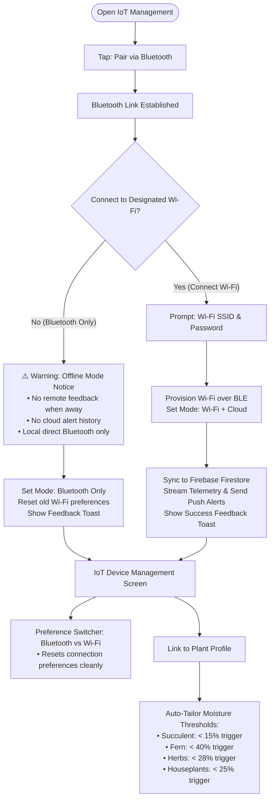

# 🌿 UrbanGreen IoT Hybrid Connectivity & Species Auto-Tailoring Architecture

This document details the newly added, fully separate IoT connectivity and species profiling modules created inside `Plant-App-Flutter-UI`.

> [!NOTE]
> **Safety Guarantee:** None of your original Flutter code files or screens have been modified. All new features are encapsulated in dedicated standalone files so your previous code remains 100% untouched as a safe fallback.

---

## 📁 Newly Created Files

1. **Species Profiling Engine**:  
   [`lib/models/plant_species_profile_model.dart`](file:///C:/Users/user/Desktop/FYP/AppIntegration/Plant-App-Flutter-UI/lib/models/plant_species_profile_model.dart)  
   Contains botanical species profiles (Succulents, Tropical, Herbs, Houseplants) with custom moisture triggers and care parameters.

2. **Connection Configuration Model**:  
   [`lib/models/iot_connection_mode.dart`](file:///C:/Users/user/Desktop/FYP/AppIntegration/Plant-App-Flutter-UI/lib/models/iot_connection_mode.dart)  
   Encapsulates connection state (`bluetoothOnly`, `wifiCloud`, `disconnected`), Wi-Fi credentials, linked plant attributes, and the **Connection Preference Reset** method.

3. **Hybrid Connectivity & Firebase Service**:  
   [`lib/services/iot_hybrid_connectivity_service.dart`](file:///C:/Users/user/Desktop/FYP/AppIntegration/Plant-App-Flutter-UI/lib/services/iot_hybrid_connectivity_service.dart)  
   Manages BLE pairing, Wi-Fi provisioning, Firestore telemetry logging (`plants/{plantId}/iot_telemetry_logs`), remote alert dispatch, and structured operation feedback (`OperationFeedback`).

4. **Dedicated Interactive UI Screen**:  
   [`lib/screens/iot/iot_advanced_management_screen.dart`](file:///C:/Users/user/Desktop/FYP/AppIntegration/Plant-App-Flutter-UI/lib/screens/iot/iot_advanced_management_screen.dart)  
   Complete screen with Bluetooth pairing flow, Wi-Fi choice prompt, offline mode warning, preference switcher, species auto-tailoring card, and live telemetry controls.

---

## 🚀 User Experience Flow



---

## 🛠️ Key Implementation Highlights

### 1. Bluetooth vs. Wi-Fi Decision & Warning
* When the user pairs via Bluetooth, the app asks:  
  *"Would you like to connect this device to your home Wi-Fi network?"*
* **If NO**: A dedicated amber **Offline Mode Notice** pops up:  
  *"⚠️ Without a Wi-Fi connection, you will NOT receive remote push notifications or cloud historical logs when away from home. You can only use simple functions to view live moisture and control the pump when within direct Bluetooth range (~10 meters)."*
* **If YES**: The app collects the Wi-Fi credentials, provisions the IoT device, and unlocks Firebase Cloud Sync.

### 2. Connection Preference Reset
* In the **Connection Method Management** card, the user can toggle between `Bluetooth Only` and `Wi-Fi + Cloud`.
* Whenever a new connection mode is chosen, the `resetConnectionPreference()` method is invoked:
  * When switching to Bluetooth, all previous Wi-Fi configurations are wiped clean.
  * When switching to Wi-Fi, the user is cleanly prompted for the target network.
  * Zero stale or conflicting connection states.

### 3. Plant Linking & Botanical Species Auto-Tailoring
* In the **Linked Plant & Species Auto-Tailoring** card, selecting any plant from the user's garden automatically extracts its species:
  * **Snake Plant / Succulent (`Sansevieria`)**: Automatically adjusts trigger to `< 15%` and cutoff to `>= 30%`.
  * **Peace Lily (`Spathiphyllum`)**: Automatically adjusts trigger to `< 35%` and cutoff to `>= 60%`.
  * **Boston Fern (`Nephrolepis`)**: Automatically adjusts trigger to `< 40%` and cutoff to `>= 65%`.
  * **Sweet Basil (`Ocimum`)**: Automatically adjusts trigger to `< 28%` and cutoff to `>= 50%`.
* Displays an informative care note and threshold badges immediately.

### 4. Comprehensive Feedback Prompts
* Every action (Pair, Choose Mode, Switch Preference, Link Plant, Unlink Plant, Manual Water Pulse) returns an `OperationFeedback` object.
* Displays a floating feedback snackbar with clear title, message, and color-coded status (Forest Green for success, Danger Red for failure, Amber for warnings).

---

## 📱 How to Launch the New Screen

To try the new screen from anywhere in your app (for example, in your bottom navigation or plant details):

```dart
import 'package:urbangreen/screens/iot/iot_advanced_management_screen.dart';

// Open the advanced IoT management screen:
Navigator.push(
  context,
  MaterialPageRoute(
    builder: (context) => const IotAdvancedManagementScreen(),
  ),
);
```

